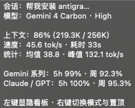
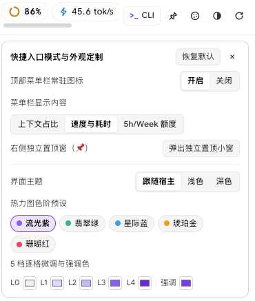
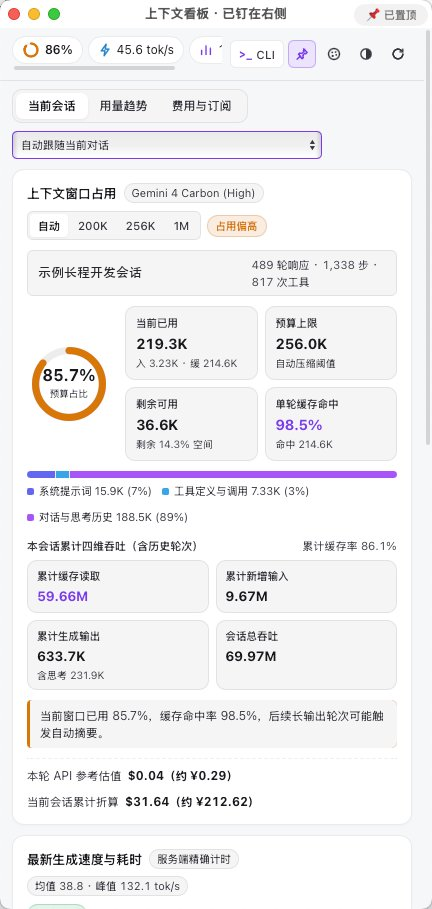
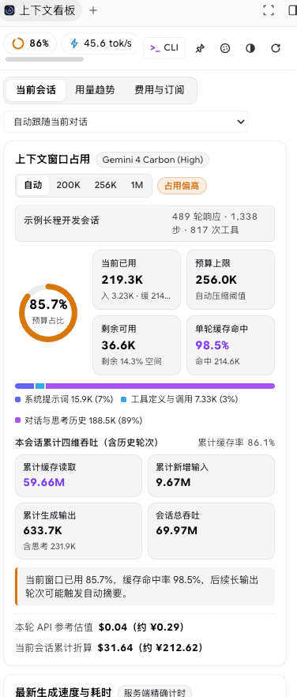
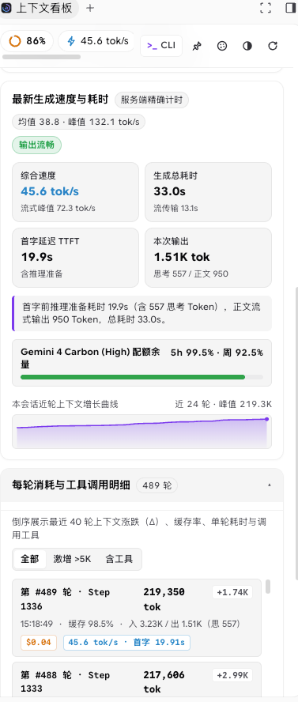
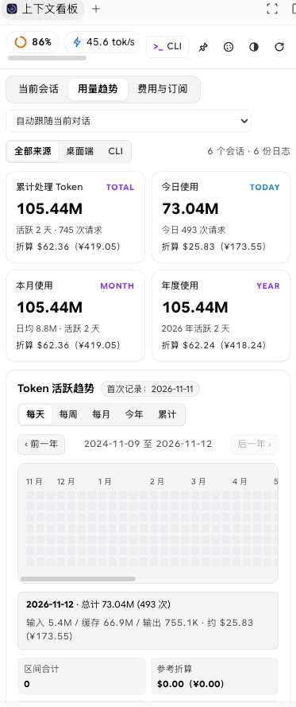
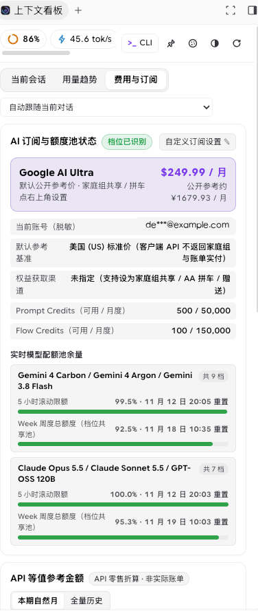

# Antigravity Context & Token Viewer (`agy-context-viewer`)

[](https://github.com/Dong-Kevin/agy-context-viewer/releases)
[](#一键安装)
[](#一键安装)
[](#隐私与安全机制)
[](./LICENSE)

**简体中文** | **[English](./README_EN.md)** · [界面预览](#界面预览) · [核心特性](#核心特性) · [一键安装](#一键安装) · [快速上手](#快速上手) · [统计维度](#核心视图与统计维度) · [隐私安全](#隐私与安全机制) · [致谢](#致谢)

面向 **Google Antigravity 桌面端（`agy` App / IDE）** 与 **终端 `agy` CLI** 的官方规范上下文窗口、生成速度（`TTFT` / `tok/s`）、`5h + Week` 双维度配额余量与 Token 历史趋势看板插件。

零客户端文件篡改、零第三方运行时依赖、100% 本地只读采集 -- 安装即享 **macOS 顶部系统菜单栏实时徽章**、**屏幕右侧独立置顶小窗（`📌`）**、**宿主右侧内嵌辅助栏** 与 **`agy-context` 终端彩色看板**。

---

## 界面预览

### 1. 顶部菜单栏常驻徽章、四段式悬停卡片与个性化定制

<table>
  <tr>
    <td width="48%" align="center" valign="middle">
      <br/>
      
      <br/><br/>
      
      <br/><br/>
      <b>macOS 菜单栏常驻徽章 & 四段式精简悬停卡片</b><br/>
      <sub>支持「上下文占比 / 速度与耗时 / 5h·Week 额度」三档快切，切换对话自动跟随；左键 <code>&lt;5ms</code> 秒开小窗</sub>
    </td>
    <td width="52%" align="center" valign="middle">
      
      <br/>
      <b>快捷入口模式与外观色阶定制</b><br/>
      <sub>一键开关菜单栏常驻、切换显示内容、弹出独立置顶小窗，内置亮暗主题与 5 套热力图预设色阶</sub>
    </td>
  </tr>
</table>

### 2. 右侧独立置顶小窗（`📌`）与三大核心数据视图

<table>
  <tr>
    <td width="33%" align="center" valign="top">
      
      <br/>
      <b>右侧独立置顶小窗（<code>📌</code> 常驻）</b><br/>
      <sub>免点侧边栏折叠菜单，与代码、终端、Artifacts 同屏常驻显示</sub>
    </td>
    <td width="33%" align="center" valign="top">
      
      <br/>
      <b>当前会话 · 上下文构成与缓存率</b><br/>
      <sub>预算水位圆环、单轮 98.5% 缓存命中、三段构成条与四维累计吞吐</sub>
    </td>
    <td width="33%" align="center" valign="top">
      
      <br/>
      <b>当前会话 · 生成速度与逐轮涨跌</b><br/>
      <sub>服务端精确 <code>tok/s</code>、首字延迟 <code>TTFT</code>、双配额条与每轮 <code>±Delta</code> 明细</sub>
    </td>
  </tr>
</table>

<table>
  <tr>
    <td width="50%" align="center" valign="top">
      
      <br/>
      <b>用量趋势 · 全端汇总与 53 周日历热力图</b><br/>
      <sub>打通桌面端与 <code>agy</code> CLI 日志，支持按日 / 周 / 月 / 今年 / 累计多维穿透</sub>
    </td>
    <td width="50%" align="center" valign="top">
      
      <br/>
      <b>费用与订阅 · Ultra / 家庭组支持与双配额池</b><br/>
      <sub>精准识别 <code>Google AI Pro / Ultra</code>，支持家庭组共享 / AA 拼车设置，同屏展示 <code>5h</code> 与 <code>Week</code> 余量</sub>
    </td>
  </tr>
</table>

---

## 核心特性

- **官方规范插件架构，零客户端破签风险**
  - 严格遵循 Antigravity 官方 `plugin.json` 与 `sidecar_sdk` 规范构建，**不解包修改 `Antigravity.app` 的 `app.asar`、不注入 CDP 渲染进程、不直接改写 `~/.gemini/config/config.json`**，完整保留 macOS `Developer ID` 签名校验与客户端自动升级。
- **macOS 顶部系统菜单栏常驻看板（3 档显示定制 + 切换会话自动跟随）**
  - 支持在 **3 种实时指标** 之间随时切换（右键菜单、面板抽屉或 CLI 双向同步）：
    1. **当前上下文使用占比**（默认）：`◈ 86%`（高水位自动切换 `⚠` 预警）
    2. **最新生成速度与耗时（含会话均值 / 峰值）**：`⚡ 46t/s·33s (均 39/峰 132)`
    3. **5 小时 / Week 配额余量**：`⏳ 5h 99%·周93%`
  - **切换对话自动跟随**：在左侧会话列表点击切换任意对话（包括未发新消息的历史静止对话）时，顶部菜单栏与右侧小窗在约 `1.5s` 内自动同步到当前浏览会话；也可在下拉框手动锁定指定会话。
  - **四段式精简悬停卡片 & `<5ms` 秒开交互**：鼠标悬停展示「会话与模型 / 水位与速度 / 分池 `5h + 周` 配额 / 快捷操作」四段概览；**左键单击** `<5ms` 秒开或收回右侧小窗，**右键单击** 弹出原生菜单切换模式与置顶。
- **屏幕右侧独立置顶小窗（`📌`，告别繁琐侧边栏切换）**
  - 一键将看板独立钉在屏幕右侧最前，即使宿主右侧辅助栏正在查看 Artifacts、Diff 或终端也互不抢占；支持标题栏按钮、面板内 `📌` 图标或快捷键 `Cmd+Shift+P` 实时切换置顶，按 `Cmd+W` 快速收回。
- **真实双窗口配额池（`5h + Week`）与灵活订阅价值对标**
  - 同时读取宿主 `GetUserStatus` 与 `RetrieveUserQuotaSummary` 只读本地接口，同屏呈现 Gemini 系列与 Claude / GPT 系列的 **5 小时滚动突发限额** 与 **Week 周度档位共享池余量** 及精确重置时间。
  - 准确识别 `Google AI Pro` / `Google AI Ultra` 等订阅档位；针对家庭组共享免付费、多人 AA 拼车、教育优惠及跨区订阅场景，内置 **10 种获取渠道**、**22 个国家或地区定价** 与 **40+ 币种汇率** 自定义折算，并与按量 API 零售估值直观对比。
- **桌面端 IDE + 终端 `agy` CLI 双端全覆盖，零第三方依赖**
  - 纯 `Node.js >= 18` 标准库与系统原生 Web / Cocoa 组件编写，`0` 外部 `npm` 依赖，跨 **macOS / Linux / Windows** 开箱即用；终端提供 `agy-context` 彩色进度条看板、`turns` 逐轮涨跌审计、`json` 脚本导出与 `web` 独立浏览器看板。

---

## 一键安装

> **前置要求**：本机已安装 `Node.js >= 18`。后续版本更新只需重新运行同一条命令即可平滑热升级。

### 方式 1：macOS / Linux 一键脚本安装（推荐）

自动安装插件、编译并启动 macOS 顶部菜单栏常驻守护进程，同时注册终端 `agy-context` 命令：

```bash
bash -c "$(curl -fsSL https://raw.githubusercontent.com/Dong-Kevin/agy-context-viewer/main/install.sh)"
```

### 方式 2：Windows PowerShell 一键安装

```powershell
irm https://raw.githubusercontent.com/Dong-Kevin/agy-context-viewer/main/install.ps1 | iex
```

### 方式 3：通过官方 `agy` CLI 安装

```bash
agy plugin install https://github.com/Dong-Kevin/agy-context-viewer
```

### 方式 4：克隆仓库或下载 Release 离线包安装

```bash
git clone https://github.com/Dong-Kevin/agy-context-viewer.git
cd agy-context-viewer
./install.sh          # Windows PowerShell 执行：.\install.ps1
```

也可在 [Releases](https://github.com/Dong-Kevin/agy-context-viewer/releases) 页面下载最新的 `context-viewer-v1.6.2.zip`，解压后执行 `./context-viewer/install.sh`（或 `agy plugin install ./context-viewer`）。

---

## 快速上手

### 1. 在 Antigravity 桌面端 / IDE 中使用

1. **顶部系统菜单栏常驻图标（macOS 默认开启）**
   - **左键单击** 屏幕右上角图标：`<5ms` 弹出或收回右侧看板小窗；
   - **右键单击** 菜单栏图标：直接勾选切换 **当前上下文使用占比 / 最新生成速度与耗时 / 5 小时与 Week 额度**，或切换小窗置顶、隐藏菜单栏图标；
   - 也可点击看板右上角调色盘按钮在「快捷入口模式与外观定制」抽屉中一键切换。
2. **屏幕右侧独立置顶小窗（`📌`）**
   - 点击看板顶栏 **`📌` 按钮** 或在终端执行 `agy-context float`，即可将看板独立钉在屏幕右侧；
   - 点击窗口标题栏右侧 `📌 已置顶`（或按 `Cmd+Shift+P`）可切换置顶 / 普通窗口层级；按 `Cmd+W`、再次左键点击菜单栏图标或运行 `agy-context float close` 即可收回。
3. **宿主右侧辅助栏内嵌模式**
   - 在左侧 **Customizations → Plugins** 中确认已启用「上下文与 Token 看板」，点击右上角辅助栏图标（或点击对话中的 `sidecar://context-viewer/dashboard/` 链接）即可内嵌分屏查看。

### 2. 在终端与 `agy` CLI 中使用

- **对话内直接调用技能**：在 `agy` 对话框中输入 `/context-viewer`，或直接提问「查看当前会话上下文占用、生成速度与配额余量」。
- **终端 `agy-context` 命令速查**：

```bash
agy-context                  # 终端彩色进度条汇总（当前窗口水位、速度、近 5 轮涨跌、双维度配额池余量）
agy-context menubar context  # 菜单栏显示：当前上下文使用占比（◈ 86%）
agy-context menubar speed    # 菜单栏显示：最新生成速度与耗时（⚡ 46t/s·33s (均 39/峰 132)）
agy-context menubar quota    # 菜单栏显示：5 小时 / Week 额度余量（⏳ 5h 99%·周93%）
agy-context menubar off      # 关闭顶部菜单栏常驻图标（传 on 重新开启，传 status 查看当前状态）
agy-context float            # 弹出 / 切换屏幕右侧独立置顶小窗（传 close 收回，传 quit 退出守护进程）
agy-context turns            # 查看最近 20 轮上下文涨跌（±Delta）、缓存率与工具调用时间线
agy-context json             # 输出结构化 JSON 摘要（追加 --full 输出完整原始载荷，便于脚本集成）
agy-context web              # 在 127.0.0.1:18970 启动本地只读 Web 服务并在浏览器打开完整看板
```

> 若仅通过 `agy plugin install` 安装而未运行 `install.sh`，可直接执行：`node ~/.gemini/config/plugins/context-viewer/sidecars/dashboard/cli.mjs`（若插件目录名为 `agy-context-viewer` 则替换为对应目录名）。

---

## 核心视图与统计维度

| 视图模块 | 核心指标与交互能力 |
| :--- | :--- |
| **当前会话** | 预算占比圆环、输入框待发送 Token 实时预估、窗口上限快切（`自动 / 200K / 256K / 1M`）、单轮与累计缓存读取命中率、三段上下文构成条（`系统提示词 / 工具定义与调用 / 对话与思考历史`，支持展开工具 Schema 字节明细）、四维累计吞吐、服务端精确 `tok/s`（综合 / 流式峰值 / 会话均值）与首字延迟 `TTFT`、当前模型 `5h + Week` 配额条、近 24 轮增长曲线、**近 40 轮消耗涨跌 `±Delta` 与工具调用筛选列表** 及多媒体附件审计。 |
| **用量趋势** | 支持 **全部来源 / 桌面端 / CLI** 一键过滤；提供累计、今日、本月、年度 4 张核心汇总卡片（含活跃天数、请求数与参考折算）；内置 **每天（53 周 GitHub 风格日历热力图） / 每周 / 每月 / 今年（12 月气泡矩阵） / 累计曲线** 5 种交互图表。 |
| **费用与订阅** | 自动识别 `Google AI Pro` / `Google AI Ultra` 等档位（登录邮箱自动脱敏）、`Prompt / Flow Credits` 与分模型组 **`5h` 滚动限额 + `Week` 周度共享池余量**；支持 **家庭组共享（免额外付费）/ 家庭组 AA 拼车 / 赠送 / 多地区币种** 自定义设置，并提供 **本期自然月 / 全量历史** API 零售等值折算与分模型消耗排行。 |

---

## 目录结构

```text
agy-context-viewer/
├── plugin.json                        # Antigravity 官方插件清单
├── install.sh                         # macOS / Linux 一键安装、热升级与卸载脚本
├── install.ps1                        # Windows PowerShell 一键安装与卸载脚本
├── assets/
│   └── logo.svg                       # 插件矢量图标
├── docs/
│   └── images/                        # README 界面预览截图（打包 Release 时自动排除，保持运行时轻量）
├── skills/
│   └── context-viewer/
│       ├── SKILL.md                   # /context-viewer 跨端技能定义
│       └── scripts/status.mjs         # 目录名无关的便携 CLI 调用入口
├── sidecars/
│   └── dashboard/
│       ├── sidecar.json               # 官方 Aux Pane UI Sidecar 声明
│       ├── main.mjs                   # Sidecar 与本地只读 HTTP 服务入口
│       ├── collector.mjs              # 会话归档解析、活跃对话跟随与双维度配额只读采集器
│       ├── pricing.mjs                # 模型窗口上限、API 定价、Ultra/家庭组与多币种订阅参考库
│       ├── float_window.mjs           # 右侧置顶小窗与 macOS 顶部菜单栏守护进程控制器
│       ├── native_float_macos.swift   # macOS 原生 NSStatusItem + WKWebView 零端口内存桥接实现
│       ├── cli.mjs                    # agy-context 终端彩色看板与快捷控制入口
│       ├── index.html                 # 看板前端页面结构
│       ├── styles.css                 # --cv-* 命名空间完全隔离样式表（自适应亮暗主题）
│       └── app.js                     # 看板前端渲染与交互逻辑
└── scripts/
    ├── verify.mjs                     # 清单规范、语法、全仓隐私/PNG 元数据审计、CSS 隔离与冒烟测试
    └── package-release.mjs            # 零依赖跨平台 Release ZIP 与 SHA-256 打包工具
```

---

## 隐私与安全机制

- **100% 本地只读采集**：仅只读解析本机 `~/.gemini/antigravity/brain/`、`~/.gemini/antigravity-cli/brain/`、`~/.gemini/antigravity/annotations/` 归档元数据与本机 `127.0.0.1` 语言服务只读状态接口，**绝不向任何外部服务器发送对话正文、文件路径、账号信息或遥测数据**。
- **敏感信息默认脱敏**：界面显示的当前账号邮箱默认自动掩码脱敏，悬停提示自动剥离冗长 URL；独立 Web 模式严格仅绑定本机回环地址 `127.0.0.1`。
- **配置完全隔离**：外观、菜单栏模式与订阅自定义参数独立保存在 `~/.gemini/antigravity/sidecar_data/context-viewer/dashboard/data/settings_v1.json`，不触碰宿主核心配置，卸载不留残余污染。

---

## 更新与卸载

- **平滑热升级**：重新执行上方任一安装命令（如 `./install.sh` 或在线 `curl` 脚本），脚本会自动完成原子替换并平滑重启菜单栏守护进程。
- **干净卸载**：
  - 脚本卸载：macOS / Linux 运行 `./install.sh --uninstall`（或在线脚本末尾加 `-s -- --uninstall`）；Windows 运行 `.\install.ps1 -Uninstall`
  - `agy` CLI 卸载：`agy plugin uninstall context-viewer`
  - 桌面端卸载：在 `customization://context-viewer` 插件详情页点击 **Uninstall**

---

## 本地开发与发布校验

```bash
node scripts/verify.mjs           # 运行清单规范、JS 语法、隐私与图片元数据审计、CSS 隔离及冒烟测试
node scripts/package-release.mjs  # 生成轻量发布包 dist/context-viewer-v1.6.2.zip 与 .sha256
```

---

## 致谢

本项目在构思之初深受开源项目 **[elviscjn-cjn/antigravity-context-viewer](https://github.com/elviscjn-cjn/antigravity-context-viewer)** 的启发 -- 该项目率先探索了 Google Antigravity 客户端的上下文窗口构成透视、Token 活跃热力图与模型配额可视化方案，为我们梳理核心观测指标与看板呈现提供了极具价值的参考。在此向原作者的开创性探索致以诚挚感谢与敬意！

站在社区先行者的肩膀上，`agy-context-viewer` 遵循 Antigravity 官方 `plugin.json` + `sidecar_sdk` 插件体系从零全新编写（免修改客户端 `app.asar`、零签名破坏），并进一步构建了 macOS 原生顶部菜单栏三档常驻徽章、切换对话自动跟随、屏幕右侧独立置顶小窗（`📌`）、`5h + Week` 双维度共享额度池、`Google AI Ultra` 与家庭组订阅折算以及 `agy` CLI 终端套件。

---

## License

基于 [MIT License](./LICENSE) 开源。
