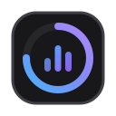
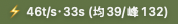
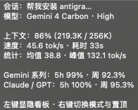
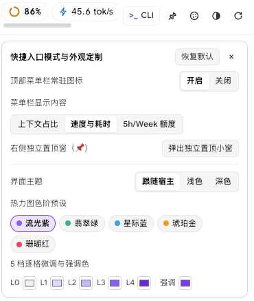
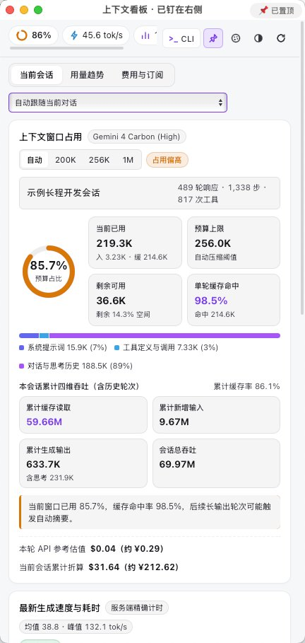
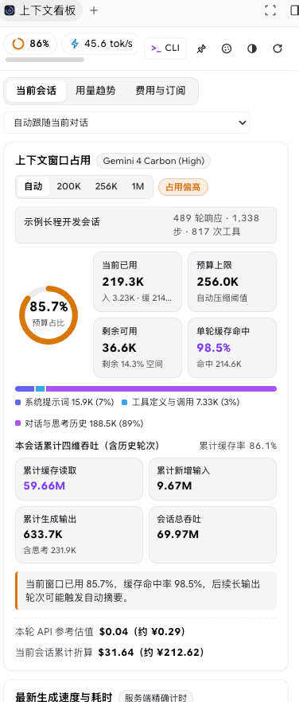
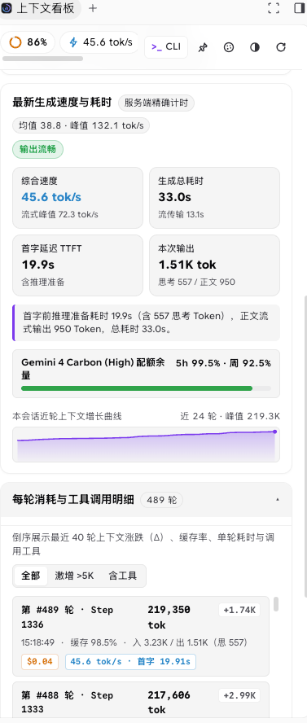
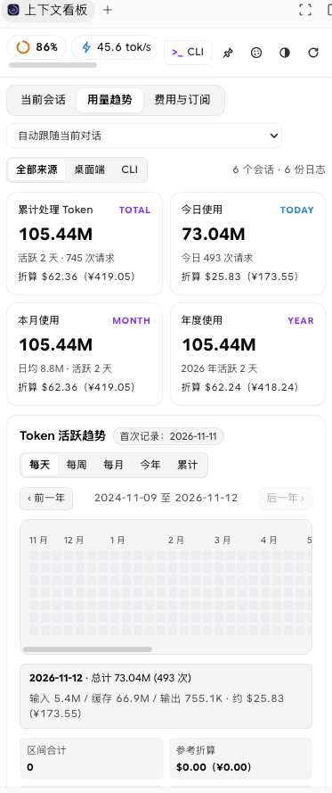
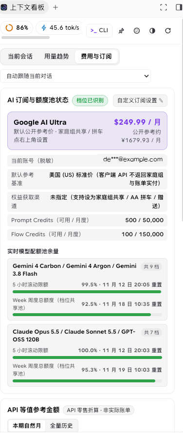

# Antigravity Context & Token Viewer (`agy-context-viewer`)

[](https://github.com/Dong-Kevin/agy-context-viewer/releases)
[](#quick-install)
[](#quick-install)
[](#privacy--security)
[](./LICENSE)

**[简体中文](./README.md)** | **English** · [Screenshots](#screenshots) · [Key Features](#key-features) · [Quick Install](#quick-install) · [Usage Guide](#usage-guide) · [Metrics Overview](#views--metrics-overview) · [Privacy & Security](#privacy--security) · [Acknowledgements](#acknowledgements)

An official-spec, real-time **Context Window**, **Generation Speed (`TTFT` / `tok/s`)**, **Dual `5h + Weekly` Model Quota**, and **Token Usage Analytics** plugin for **Google Antigravity Desktop (`agy` App / IDE)** and the **`agy` CLI**.

Zero client binary patching, zero external runtime dependencies, and 100% local read-only telemetry — featuring a **customizable macOS Menu Bar live indicator**, a **right-side pinned floating window (`📌`)**, native **Aux Pane Sidecar integration**, and a full **`agy-context` terminal dashboard**.

---

## Screenshots

### 1. macOS Menu Bar Live Badge, 4-Section Hover Card & Customizer Drawer

<table>
  <tr>
    <td width="48%" align="center" valign="middle">
      <br/>
      
      <br/><br/>
      
      <br/><br/>
      <b>macOS Menu Bar Live Badge & Compact 4-Section Tooltip</b><br/>
      <sub>Switch between Context %, Speed & Duration, and 5h/Weekly Quota; auto-follows active conversations; left-click toggles window in <code>&lt;5ms</code></sub>
    </td>
    <td width="52%" align="center" valign="middle">
      
      <br/>
      <b>Quick Entry Modes & Appearance Customizer</b><br/>
      <sub>Toggle Menu Bar badge, switch live metric mode, launch the pinned window, and pick from light/dark themes + 5 heatmap palettes</sub>
    </td>
  </tr>
</table>

### 2. Right-Side Pinned Floating Window (`📌`) & Core Analytics Views

<table>
  <tr>
    <td width="33%" align="center" valign="top">
      
      <br/>
      <b>Pinned Floating Window (<code>📌</code>)</b><br/>
      <sub>Stays pinned cleanly on the right edge alongside your editor, terminal, and Artifacts without panel-switching</sub>
    </td>
    <td width="33%" align="center" valign="top">
      
      <br/>
      <b>Session · Context & Cache Breakdown</b><br/>
      <sub>Budget gauge, 98.5% cache hit ratio, 3-part prompt breakdown bar, and 4D cumulative token throughput</sub>
    </td>
    <td width="33%" align="center" valign="top">
      
      <br/>
      <b>Session · Speed & Per-Turn <code>±Delta</code></b><br/>
      <sub>Server-timed <code>tok/s</code>, <code>TTFT</code>, dual quota bar, growth sparkline, and per-turn <code>±Delta</code> audit list</sub>
    </td>
  </tr>
</table>

<table>
  <tr>
    <td width="50%" align="center" valign="top">
      
      <br/>
      <b>Usage Trends · Desktop + CLI & 53-Week Heatmap</b><br/>
      <sub>Unified Desktop & <code>agy</code> CLI token analytics across Daily, Weekly, Monthly, Yearly, and Cumulative views</sub>
    </td>
    <td width="50%" align="center" valign="top">
      
      <br/>
      <b>Cost & Quotas · Ultra / Family Sharing & Dual Pools</b><br/>
      <sub>Detects <code>Google AI Pro / Ultra</code>, supports Family Group sharing / split-billing, and tracks both <code>5h</code> & <code>Weekly</code> quota pools</sub>
    </td>
  </tr>
</table>

---

## Key Features

- **100% Non-Intrusive Official Plugin Architecture**
  - Built strictly on Antigravity's official `plugin.json` and `sidecar_sdk` specifications. **Never patches `Antigravity.app`'s `app.asar`, never requires CDP debug-port injection, and never rewrites `~/.gemini/config/config.json`** — keeping macOS `Developer ID` code-signing and automatic IDE updates completely intact.
- **Customizable macOS Menu Bar Live Indicator + Auto Conversation Follow**
  - Seamlessly switch between **3 real-time menu bar metrics** (synced across the right-click menu, dashboard drawer, and CLI):
    1. **Context Window Usage %** (Default): `◈ 86%` (auto-escalates to `⚠` at high watermark)
    2. **Latest Speed & Duration (with Session Avg / Peak)**: `⚡ 46t/s·33s (均 39/峰 132)`
    3. **5-Hour / Weekly Quota Remaining**: `⏳ 5h 99%·周93%`
  - **Automatic Conversation Follow**: Clicking any conversation in the Antigravity sidebar (including idle historical threads without sending a new message) automatically syncs the Menu Bar badge and floating window within `~1.5s`. Manual session locking is also supported via the dropdown selector.
  - **Compact 4-Section Hover Tooltip & `<5ms` Toggle**: Hover for a clean summary of active conversation/model, context & speed stats, `5h + Weekly` model pool quotas, and shortcuts; **left-click** toggles the dashboard window in `<5ms`, and **right-click** opens the native quick-switch menu.
- **Right-Side Pinned Floating Window (`📌`)**
  - Pin the dashboard directly to the right edge of your screen so it remains visible even when the IDE's right Auxiliary Pane is displaying Artifacts, Diffs, or Terminals. Toggle always-on-top anytime via the title bar pill, the `📌` toolbar icon, or `Cmd+Shift+P` (`Cmd+W` to hide).
- **Dual-Window Quota Pools (`5h + Weekly`) & Realistic Subscription Modeling**
  - Queries both read-only `GetUserStatus` and `RetrieveUserQuotaSummary` local language-server RPCs to display **5-hour rolling burst limits** alongside **Weekly shared tier pools** and exact reset timestamps for Gemini and Claude / GPT families.
  - Accurately identifies `Google AI Pro` and `Google AI Ultra` tiers, and includes built-in customization for **Family Group Sharing (`$0` extra cost)**, **Family Split-Billing (AA)**, **22 regional pricing presets**, and **40+ currencies**, side-by-side with retail API pay-as-you-go equivalence.
- **Unified Desktop IDE + `agy` CLI Experience with Zero Dependencies**
  - Powered purely by the `Node.js >= 18` standard library and native OS components (`0` external `npm` packages), working out of the box across **macOS, Linux, and Windows** — complete with `agy-context` ANSI terminal bars, `turns` delta tables, `json` export, and standalone `web` mode.

---

## Quick Install

> **Prerequisite**: `Node.js >= 18` installed locally. Re-running any install command performs an atomic, zero-downtime hot upgrade.

### Option 1: macOS / Linux One-Liner (Recommended)

Installs the plugin, compiles & launches the native macOS Menu Bar helper, and registers the `agy-context` CLI command:

```bash
bash -c "$(curl -fsSL https://raw.githubusercontent.com/Dong-Kevin/agy-context-viewer/main/install.sh)"
```

### Option 2: Windows PowerShell One-Liner

```powershell
irm https://raw.githubusercontent.com/Dong-Kevin/agy-context-viewer/main/install.ps1 | iex
```

### Option 3: Install via Official `agy` CLI

```bash
agy plugin install https://github.com/Dong-Kevin/agy-context-viewer
```

### Option 4: Git Clone or Offline Release ZIP

```bash
git clone https://github.com/Dong-Kevin/agy-context-viewer.git
cd agy-context-viewer
./install.sh          # On Windows PowerShell: .\install.ps1
```

Or download `context-viewer-v1.6.2.zip` from [Releases](https://github.com/Dong-Kevin/agy-context-viewer/releases), extract it, and run `./context-viewer/install.sh` (or `agy plugin install ./context-viewer`).

---

## Usage Guide

### 1. In Antigravity Desktop / IDE

1. **macOS System Menu Bar Icon (Enabled by Default on macOS)**
   - **Left-click** the top-right menu bar badge to show or hide the floating dashboard in `<5ms`;
   - **Right-click** the badge to switch live display modes (**Context % / Speed & Duration / 5h & Weekly Quota**), toggle window pin state, or hide the menu bar icon;
   - You can also configure everything visually inside the dashboard's top-right palette customizer drawer.
2. **Right-Side Pinned Floating Window (`📌`)**
   - Click the **`📌` button** in the dashboard header or run `agy-context float` in your terminal to pin the dashboard on the right side of your screen;
   - Click the title-bar `📌` pill (or press `Cmd+Shift+P`) to toggle always-on-top; press `Cmd+W`, left-click the menu bar badge again, or run `agy-context float close` to dismiss.
3. **Embedded Auxiliary Pane Sidecar**
   - Ensure the plugin is enabled under **Customizations → Plugins**, then click its icon in the right Auxiliary Pane (or open `sidecar://context-viewer/dashboard/`).

### 2. In Terminal & `agy` CLI

- **In-Chat Skill**: Type `/context-viewer` inside any `agy` session, or ask naturally about your current context window usage, speed, or quota pools.
- **Terminal `agy-context` CLI Reference**:

```bash
agy-context                  # Rich ANSI summary (context gauge, speed, last 5 turns ±Delta, 5h/Weekly quotas)
agy-context menubar context  # Menu Bar mode: Context Window % (◈ 86%)
agy-context menubar speed    # Menu Bar mode: Latest Speed & Duration (⚡ 46t/s·33s)
agy-context menubar quota    # Menu Bar mode: 5h / Weekly Quota Remaining (⏳ 5h 99%·周93%)
agy-context menubar off      # Hide Menu Bar badge (pass 'on' to re-enable, 'status' to inspect)
agy-context float            # Open / toggle the right-side pinned floating window ('close' to hide, 'quit' to stop daemon)
agy-context turns            # Inspect the last 20 turns with context ±Delta, cache hit %, and tool calls
agy-context json             # Structured JSON summary (append --full for complete raw telemetry payload)
agy-context web              # Start standalone local web UI on 127.0.0.1:18970 and open in default browser
```

> If you installed solely via `agy plugin install` without running `install.sh`, invoke the CLI directly via `node ~/.gemini/config/plugins/context-viewer/sidecars/dashboard/cli.mjs` (replace `context-viewer` with `agy-context-viewer` if cloned under the repo name).

---

## Views & Metrics Overview

| Tab | Tracked Metrics & Interactive Capabilities |
| :--- | :--- |
| **Current Session** | Context budget ring gauge, live unsent input token estimator, budget ceiling switcher (`Auto / 200K / 256K / 1M`), per-turn & cumulative prompt cache hit rate, 3-segment context composition bar (`System Prompt / Tools / Chat & Thinking`, expandable per-tool schema byte breakdown), 4D cumulative token throughput, server-timed `tok/s` (overall, streaming peak, session mean) & `TTFT`, active model `5h + Weekly` quota bar, 24-turn growth sparkline, **filterable 40-turn `±Delta` & tool-call timeline**, and attachment audit. |
| **Usage Trends** | Filter across **All Sources / Desktop / CLI**; 4 headline summary cards (All-Time, Today, Month, Year with active days, request counts, and API cost equivalent); 5 interactive chart modes: **Daily (53-week GitHub-style calendar heatmap), Weekly, Monthly, Yearly (12-month bubble matrix), and Cumulative**. |
| **Cost & Subscription** | Automatic plan tier detection (`Google AI Pro` / `Google AI Ultra`, masked account email), `Prompt / Flow Credits`, and grouped **`5h` burst + `Weekly` shared quota pools**; customizable **Family Group Sharing (`$0` extra) / Split-Billing / Gifted / 22 regional presets / 40+ currencies**, plus **Current Month vs. All-Time** retail API valuation and per-model breakdown. |

---

## Project Structure

```text
agy-context-viewer/
├── plugin.json                        # Official Antigravity plugin manifest
├── install.sh                         # macOS / Linux installer, hot-upgrader & uninstaller
├── install.ps1                        # Windows PowerShell installer & uninstaller
├── assets/
│   └── logo.svg                       # Vector plugin icon
├── docs/
│   └── images/                        # Sanitized README screenshots (excluded from lightweight Release ZIP)
├── skills/
│   └── context-viewer/
│       ├── SKILL.md                   # /context-viewer cross-surface skill definition
│       └── scripts/status.mjs         # Directory-agnostic portable CLI entry
├── sidecars/
│   └── dashboard/
│       ├── sidecar.json               # Official Aux Pane UI Sidecar configuration
│       ├── main.mjs                   # Sidecar & loopback HTTP server entrypoint
│       ├── collector.mjs              # Read-only session parser, active-chat follower & dual-quota collector
│       ├── pricing.mjs                # Model context limits, API pricing, Ultra/Family presets & FX rates
│       ├── float_window.mjs           # Pinned floating window & macOS Menu Bar daemon controller
│       ├── native_float_macos.swift   # Native macOS NSStatusItem + WKWebView zero-port IPC bridge
│       ├── cli.mjs                    # agy-context ANSI terminal dashboard & control CLI
│       ├── index.html                 # Dashboard markup
│       ├── styles.css                 # Strict --cv-* namespaced styles (host light/dark adaptive)
│       └── app.js                     # Frontend rendering & interactive state
└── scripts/
    ├── verify.mjs                     # Manifest, syntax, privacy/PNG-chunk audit, CSS isolation & smoke tests
    └── package-release.mjs            # Zero-dependency cross-platform Release ZIP & SHA-256 packager
```

---

## Privacy & Security

- **100% Local Read-Only Telemetry**: Reads only local session metadata under `~/.gemini/antigravity/brain/`, `~/.gemini/antigravity-cli/brain/`, `~/.gemini/antigravity/annotations/`, and read-only `127.0.0.1` language-server status endpoints. **Zero conversation prompts, file paths, account credentials, or analytics ever leave your machine.**
- **Redacted by Default**: Account emails displayed in the UI are automatically masked, long URLs are stripped from hover tooltips, and standalone web mode binds strictly to loopback `127.0.0.1`.
- **Isolated Plugin Storage**: User preferences (theme, palette, menu bar mode, custom subscription overrides) are stored cleanly under `~/.gemini/antigravity/sidecar_data/context-viewer/dashboard/data/settings_v1.json` without touching `~/.gemini/config/config.json`.

---

## Upgrade & Uninstall

- **Hot Upgrade**: Re-run any installation command above (e.g., `./install.sh` or the `curl` one-liner) to atomically update files and seamlessly reload the Menu Bar helper.
- **Clean Uninstall**:
  - Via script: `./install.sh --uninstall` on macOS / Linux (or append `-s -- --uninstall` to the `curl` command); `.\install.ps1 -Uninstall` on Windows
  - Via `agy` CLI: `agy plugin uninstall context-viewer`
  - Via Desktop IDE: Open `customization://context-viewer` and click **Uninstall**

---

## Local Development & Verification

```bash
node scripts/verify.mjs           # Manifest spec, JS syntax, privacy + PNG metadata audit, CSS isolation & smoke test
node scripts/package-release.mjs  # Build lightweight dist/context-viewer-v1.6.2.zip + .sha256
```

---

## Acknowledgements

This project was originally inspired by **[elviscjn-cjn/antigravity-context-viewer](https://github.com/elviscjn-cjn/antigravity-context-viewer)** — the pioneering open-source project that first explored context window breakdown, token activity heatmaps, and model quota visualization for Google Antigravity. Its thoughtful metric dimensions and visual clarity served as a valuable reference when we began designing our workflow. Huge thanks and respect to the original author!

Building upon that inspiration, `agy-context-viewer` was engineered from scratch as a clean-room, official-spec Antigravity Plugin (`plugin.json` + `sidecar_sdk`) — requiring zero `app.asar` modification and preserving native app code-signing — while introducing a native macOS Menu Bar 3-mode live badge, automatic conversation-switch follow, a right-side pinned floating window (`📌`), dual `5h + Weekly` shared quota pools, `Google AI Ultra` & Family Sharing cost modeling, and a full `agy` CLI terminal suite.

---

## License

Released under the [MIT License](./LICENSE).
